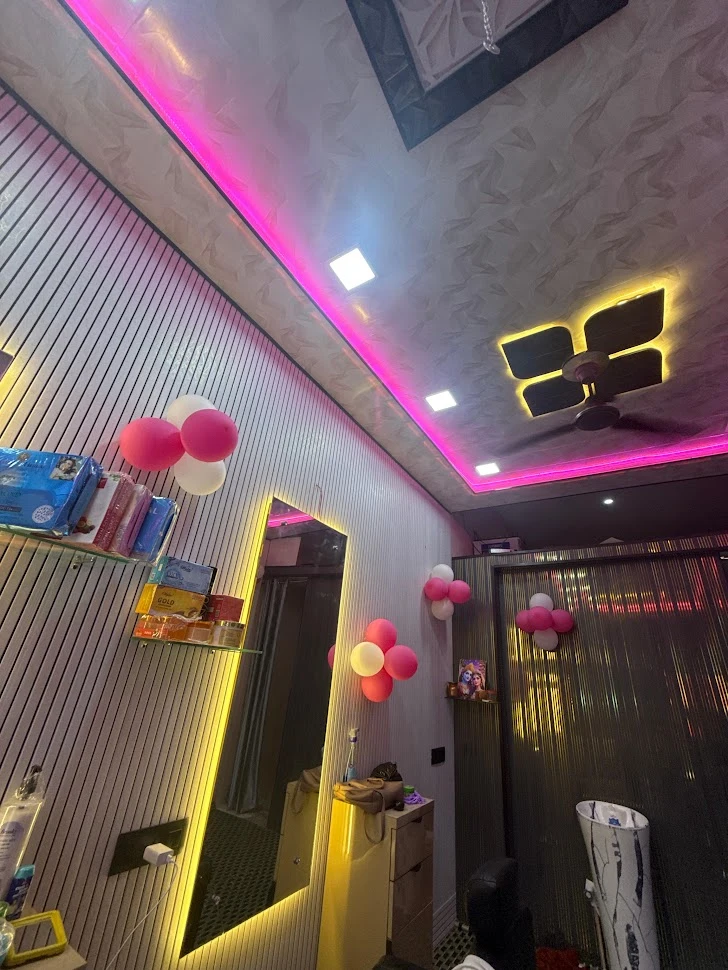
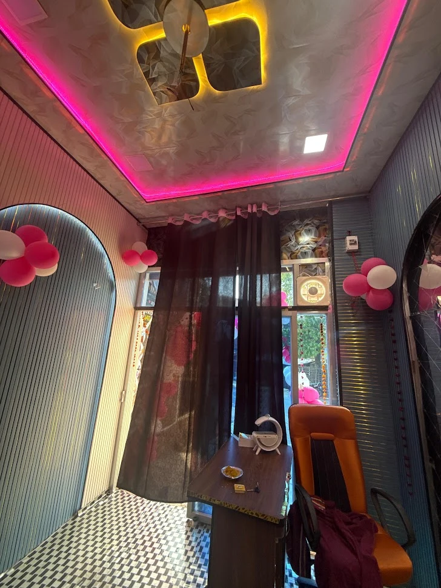

<h1 align="center">Mirror Magic Beauty Parlour</h1>
<p align="center"><em>A look inside the studio on Kurra Road, Rath.</em></p>

<p align="center">
  <a href="https://raw.githubusercontent.com/Mohitrath/Mirror-Magic-Beauty-Parlour-/main/public/images/styling-mirror.webp"></a>
  &nbsp;
  <a href="https://raw.githubusercontent.com/Mohitrath/Mirror-Magic-Beauty-Parlour-/main/public/images/reception.webp"></a>
</p>
<p align="center"><em>The styling mirror and the reception corner. Select either photo for a closer look.</em></p>

Mirror Magic’s booking website lets visitors explore hair, skin, makeup and nail services, choose a specialist, and reserve an available time. The gallery uses the studio’s own photographs, with a gentle 3D tilt on desktop and tap-to-enlarge on mobile.

[Run locally](#run-locally) · [Deploy to Vercel](#deploy-to-vercel) · [Staff access](#staff-access) · [Project files](#project-files)

## Booking a visit

1. **Choose a treatment.** Filter the service menu by category and check how long each treatment takes.
2. **Reserve a time.** Choose a specialist and an available slot, then save the booking reference from the confirmation.
3. **Manage the appointment.** Open **My bookings** to reschedule or cancel. On another device, look up the visit with the reference and the email used to book.

The app uses Next.js and TypeScript. Local development uses a SQLite file. The Vercel deployment uses a separate Turso database and starts with the sample service menu and stylists.

## Run locally

Install **Node.js 24.x** with npm, then run:

```bash
git clone https://github.com/Mohitrath/Mirror-Magic-Beauty-Parlour-.git mirror-magic
cd mirror-magic
npm ci
npm run dev
```

Open [localhost:3000](http://localhost:3000). The first run creates `studio.db` in the project folder. If you downloaded the ZIP, extract it, open the folder containing `package.json`, and start with `npm ci`. To test the production build, stop the development server and run `npm run build` followed by `npm start`.

## Deploy to Vercel

1. Create a [Turso database](https://app.turso.tech/) and generate a read/write database token.
2. [Import this repository into Vercel](https://vercel.com/new). Choose **Next.js**, **Node.js 24.x**, and the repository root (`./`). Keep the default build and output settings.
3. Add the environment variables below to **Production** and click **Deploy**. The build creates the database tables. For preview deployments, use a separate test database and token.

| Environment variable | What to enter |
| --- | --- |
| `TURSO_DATABASE_URL` | The database URL beginning with `libsql://` |
| `TURSO_AUTH_TOKEN` | The private read/write token for that database |
| `STUDIO_STAFF_KEY` | Optional private key of at least 32 characters for the staff desk |

After deployment, open `/api/health` to check database connectivity. To verify the customer flow, reserve a test appointment, reload **My bookings**, and cancel it. Appointments made on the original ChatGPT-hosted site stay in that site’s database.

## Staff access

Staff can manage appointments and edit the service menu at `/staff`. Generate a private access key with:

```bash
node -e "console.log(require('node:crypto').randomBytes(32).toString('hex'))"
```

Save the value as `STUDIO_STAFF_KEY` in Vercel and redeploy. For local use, copy `.env.example` to `.env.local`, set the key there, and restart the server. Enter the key at `/staff`. Sessions last eight hours. Rotating the key and redeploying ends earlier sessions.

<details>
<summary><strong>Setup troubleshooting</strong></summary>

- **Missing database configuration during build?** Check both Turso variable names, the token’s write access, and the selected Vercel environment. Redeploy after saving changes.
- **Vercel can’t detect Next.js?** Set the root directory to the folder containing `package.json`.
- **Testing with a hosted database locally?** Put the development database URL and token in `.env.local`, then restart the server.

</details>

## Project files

| Location | What you’ll find |
| --- | --- |
| `app/` | Pages and API routes |
| `components/studio/` | Interactive gallery, booking forms and staff dashboard |
| `lib/server/` | Availability checks, appointment changes and staff sessions |
| `db/` and `drizzle/` | Database connection and SQL schema |
| `scripts/` | Database setup and source download generator |
| `public/images/` | Original studio photographs and service imagery |

[Next.js on Vercel](https://vercel.com/docs/frameworks/full-stack/nextjs) · [Turso TypeScript client](https://docs.turso.tech/sdk/ts/reference)
